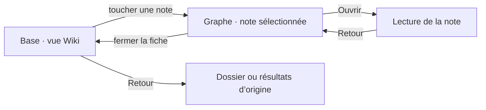

# Architecture proposée pour Datalith mobile

Revue de la PR #89 au commit `06d30d2`. Ce document décrit des choix de conception à essayer. Claude Opus 5.5 a examiné le code, les parcours et la répartition des responsabilités. Le premier parcours à rendre utilisable est **retrouver une note à partir de ses liens dans un graphe, la lire et revenir au même endroit**.

## Pourquoi le graphe échoue au toucher

Le canevas écoute la souris et la molette. Le même déplacement fait bouger un nœud ou déplace la caméra selon l’endroit où le doigt tombe. Quatre unités de déplacement suffisent pour transformer un appui en glissement. La cible est le rayon dessiné dans le repère du graphe : dézoomer la rend de plus en plus petite. Le cadrage initial plafonne le zoom à 1,5 ; le rendu attend 2,5 avant d’afficher les noms sans survol. Un graphe fraîchement cadré démarre donc sans libellés persistants. Relâcher un nœud ouvre directement son document. Un utilisateur au doigt doit donc identifier une note avant de pouvoir lire son nom. [Interactions](../../crates/datalith-ui/src/viewers/base/graph/mod.rs) · [Cibles et libellés](../../crates/datalith-ui/src/viewers/base/graph/model.rs)

### Contrat tactile à prototyper

| Intention | Interaction proposée | Résultat vérifiable |
| --- | --- | --- |
| Explorer | Glisser à un doigt pour déplacer la caméra, y compris depuis un nœud. Pour la première livraison, zoomer avec +/− et recadrer avec Ajuster. Ajouter le pincement autour du milieu des doigts une fois le backend validé. | Le point du graphe sous les doigts reste stable. Un panoramique terminé sur une note ne l’ouvre pas. Le bord réservé au Retour système reste disponible. |
| Identifier | Toucher un nœud pour le sélectionner. Stabiliser les positions pendant la manipulation. | Son nom et ses connexions deviennent lisibles. Agrandir la zone tactile dans le repère de l’écran. Si plusieurs nœuds sont indissociables au toucher, proposer leurs noms. |
| Ouvrir et revenir | Une fiche présente le nom, les liens et l’action Ouvrir. Sur un petit écran, la fiche apparaît en bas, au-dessus de la zone système. | Le retour depuis la note restaure la vue de Base, le nœud et la caméra. Fermer la fiche laisse le graphe visible. |
| Explorer sans pincer | Offrir Ajuster à l’écran et un accès par noms aux notes et relations du graphe. | Une personne peut retrouver et ouvrir la même note avec un seul doigt ou un lecteur d’écran. Le dessin ne constitue pas son seul point d’entrée. |

Les gestes proposés suivent les conventions iOS ; l’alternative à une manipulation multipoint reprend un principe d’accessibilité également documenté par le W3C pour le Web. Sur Android, préserver les gestes système des deux bords. [Gestes Apple](https://developer.apple.com/design/human-interface-guidelines/gestures) · [Alternatives aux gestes multipoints](https://www.w3.org/WAI/WCAG22/Understanding/pointer-gestures.html) · [Navigation gestuelle Android](https://developer.android.com/develop/ui/views/touch-and-input/gestures/gesturenav)

**Option pour les graphes denses.** Permettre d’isoler les voisins de la note sélectionnée, puis de revenir à la carte entière. Da Lozzo, Di Battista et Ingrassia ont implémenté une exploration de graphe par voisinage sur smartphone. Pour Datalith, l’essai doit déterminer si ce mode aide à retrouver une note sans faire perdre le contexte de la Base. [Étude originale, *Drawing Graphs on a Smartphone*](https://jgaa.info/index.php/jgaa/article/view/paper252)

## Parcours et propriétaires de l’état

| Parcours | Présentation mobile | État à conserver |
| --- | --- | --- |
| Coffre → recherche → note | Afficher le dossier courant et la portée de la recherche. Au toucher d’un résultat, ouvrir le document. | Chemin du dossier, requête, position de la liste, résultat actif. Aujourd’hui le filtre porte sur les noms du dossier courant. Une recherche globale devrait utiliser le catalogue et annoncer sa portée. |
| Note → lien → Retour | Conserver un historique unique des destinations visitées. Le système pilote le geste de retour et son annulation. | Document, mode de lecture ou d’édition, défilement et sélection. La fermeture du clavier, d’une fiche et d’un document sont des transitions distinctes. |
| Base → vue → élément | Donner accès aux vues du fichier depuis leur nom courant. Sur un écran étroit, rendre l’identité de chaque ligne lisible ; ouvrir sa fiche pour les propriétés longues. Vérifier séparément cartes, tableau et colonnes kanban. | Nom de vue, tri, sélection et défilement par vue. Les options de présentation du téléphone restent en mémoire d’interface. |
| Supprimer → annuler | Action destructive dans le menu, bannière basse avec Annuler à portée du pouce. | Le coffre gère le déplacement en corbeille ; la navigation mémorise où revenir après restauration. |
| Changement de largeur ou de posture | Sur téléphone, une destination au premier plan. Sur grand écran, coffre et document côte à côte quand les deux sont lisibles. Sur le Duo fermé, Retour et actions dans le rail système. | La même session de document et les mêmes destinations survivent au changement de présentation, y compris pendant la saisie. |

La largeur utile, le clavier et les réserves système déterminent la place disponible. Évaluer les deux colonnes avec des notes longues et la taille de texte agrandie. Android documente le passage liste/détail entre un et deux panneaux ; UIKit déplace les contrôles dans le rail du Duo. Les composants, icônes et couleurs du contenu restent ceux de Datalith. [Disposition Android](https://developer.android.com/develop/adaptive-apps/guides/list-detail) · [iPhone Duo](https://developer.apple.com/design/human-interface-guidelines/designing-for-iphone-duo)

### Exemple de retour depuis le graphe

Sur grand écran, la fiche peut prendre place à côté du graphe. Ouvrir la note utilise d’abord le panneau de détail existant. Une troisième colonne permanente réduirait la surface de lecture et ajouterait un historique ; la tester seulement si les usages sur iPad la justifient.

### Découpage technique

- **`datalith-core` et `datalith-vault`** conservent les définitions de vues, les chemins, les relations, la recherche et les opérations sur les fichiers.
- **`datalith-ui`** conserve les tampons, visionneuses, modèles de Base, caméra et moteur du graphe. Ajouter une interaction tactile qui exploite ces modèles. GPUI 0.3.12 expose `on_pinch`, mais son reconnaisseur tactile ignore les contacts supplémentaires. Son glissé à un doigt peut produire un événement de défilement que le graphe interprète comme un zoom. Prototyper la prise en charge du déplacement tactile via `TouchDragEvent` et vérifier tap, glissé et annulation sur chaque backend avant de toucher aux dépendances. [Reconnaisseur de GPUI 0.3.12](https://docs.rs/crate/gpui-pre/0.3.12/source/src/gestures.rs#527) La sélection persistante doit être distincte du survol desktop.
- **`apps/mobile`** possède l’historique de navigation, les présentations temporaires et la restauration. La couche GPUI rend le contenu et expose des actions sémantiques pour les lignes et les nœuds. La coque native relaie les contrôles système, le clavier, les zones réservées et le cycle du geste Retour. Éviter deux historiques qui peuvent diverger.
- **Accessibilité** : vérifier avec VoiceOver et TalkBack que les éléments annoncent nom, rôle, sélection et action. Tester des cibles de 44 points sur iOS et de 48 dp sur Android, texte agrandi, réduction des animations et alternative à chaque geste complexe. [Apple](https://developer.apple.com/design/human-interface-guidelines/accessibility) · [Android](https://developer.android.com/guide/topics/ui/accessibility/apps)

## Autres décisions de la revue de Claude

- **Commandes de l’écran.** Remplacer les entiers et booléens transmis au chrome iOS par des commandes nommées et un état dérivé de la destination active. Rendre le nom du document identifiable en édition même si le fichier ne contient aucun titre Markdown. Sur le Duo fermé, préserver la hauteur du contenu et laisser le système placer les commandes.
- **Recherche et retour.** Distinguer « Ce dossier » et « Tout le coffre ». La recherche globale, la création de notes et la gestion des documents ouverts constituent des lots produit à arbitrer. Une feuille de documents ouverts peut se tester séparément de l’historique de navigation.
- **Édition.** Garder le clavier, le tampon et la sélection déjà vérifiés. Évaluer les commandes Markdown difficiles à saisir (par exemple `[[`) avec un clavier affiché. Garder la sauvegarde actuelle pendant ces essais ; modifier sa politique demanderait des tests de suspension, d’arrêt inattendu et de conflit.
- **Bases.** En compact, essayer une fiche de ligne avec le nom du fichier et toutes ses propriétés. Quand le tableau est utile pour comparer deux livres, garder la colonne d’identité visible en défilement horizontal. Vérifier les propriétés longues dans les cartes. Donner accès à « Déplacer vers la colonne… » depuis la carte kanban.
- **Feedback et accessibilité.** Afficher une confirmation réversible et refermable après suppression. Vérifier que le lecteur d’écran annonce la bannière et qu’Annuler reste accessible lorsque le clavier est visible. Rendre la légende du graphe repliable, avec une alternative aux couleurs seules.

## Livraison et essais

1. **Prototype graphe sur un vrai parcours.** Ouvrir `Overview.base → Wiki`, identifier une note par son nom, inspecter ses liens, ouvrir la note, revenir, puis retrouver la vue d’ensemble. Observer les erreurs de ciblage avec une main sur un iPhone classique et avec le rail sur le Duo. Rejouer avec un graphe dense, vide et à un seul nœud. Valider le modèle de sélection avant de modifier tous les écrans.
2. **Navigation et adaptation.** Rejouer dossier → recherche → note → lien → Retour, y compris un geste annulé à mi-chemin. Replier le Duo pendant l’édition, redimensionner l’iPad et ouvrir le clavier sous Android. Le document, le curseur, le défilement et la requête doivent rester reconnaissables ; vérifier l’ordre de fermeture du clavier et des présentations temporaires.
3. **Bases et outils de lecture.** Dans `examples/bases/Library.base`, changer de vue, identifier le livre sur une ligne large, lire toutes ses propriétés dans Covers et revenir à la même ligne. Pour le kanban, proposer le choix d’une colonne depuis la carte en plus du glisser-déposer. Tester avec le fichier existant à quatre vues et le fichier livré à cinq vues, qui contient Reading board.
4. **Vérification avant livraison.** Essayer sur téléphone physique avec VoiceOver et TalkBack. Couvrir tap, défilement, pincement, clavier avec composition, retour système et réduction des animations. Lancer les mêmes scénarios sur Android avant de conclure à la parité. Un build réussi ne valide pas les gestes.

Sur le Duo simulé, le test de cette revue a ouvert `Overview.base → Wiki` sur l’écran externe puis déplié l’appareil. Le rail est resté à droite et le coffre est apparu à gauche. Les points et la légende étaient visibles dans les deux postures ; aucun nom de note n’était affiché dans le graphe au cadrage initial. Android et iPad restent à vérifier sur appareil dans cette revue.
